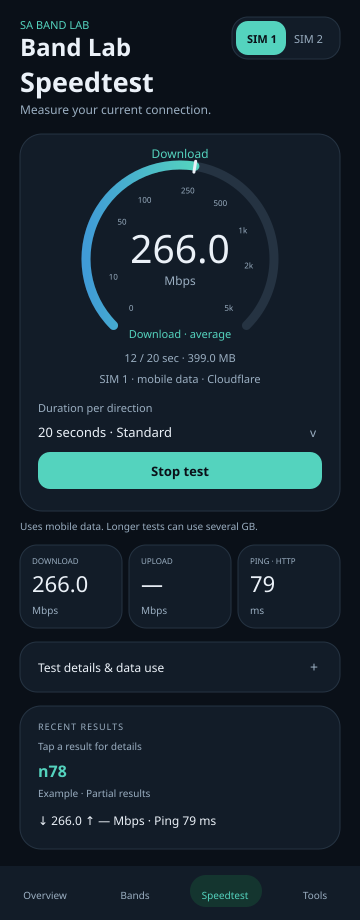

# Compare bands with Speedtest

The guide below describes the **unreleased follow-up source**, awaiting build
approval. The downloadable **0.11 APK** still has a fixed 100 MB download / 20 MB
upload limit, three-second response timeout and the previous text-heavy screen.

The user's 0.11 phone report confirms a completed download around **266 Mbps**,
HTTP response latency around **79 ms** and fresh **n78** serving observations.
Upload timed out and has no valid rate in that report. The new source addresses
that timeout and presentation; its behavior still needs a new phone test.

This is an illustrative layout reference with example values, **not an Android
screenshot or proof of measured performance**. Native Android views still need
rendering, scaling, rotation and touch validation on the phone.

## Run a test

1. Select your SIM in the app header. Make that SIM the phone's **mobile-data
   SIM** in Android settings, enable mobile data, and turn Wi-Fi and VPN off.
2. In **Bands**, read live preferences, select bands and NR-only if wanted,
   then use **Apply SA bands until reboot**. Wait for verification and usable
   service. Unapplied choices block testing; a speed test never applies them.
3. Open **Speedtest**, between Bands and Tools. Choose **20 seconds · Standard**
   or **60 seconds · Extended** per direction, then tap **Start speed test**.
4. If the phone's Location switch is off, choose **Open Location settings**,
   turn Location on, return to the app and tap Start again. This prompt appears
   only when Location is disabled. Grant Phone and **Precise** location permission
   if requested. Refresh network uses the same Location-switch check.
5. Read the data-use confirmation and tap **Start test**. Keep the app open.
   The test runs for the selected time in each direction, with **no fixed MB
   cutoff**. At 1 Gbps, 20 seconds uses roughly **2.5 GB per direction**;
   60 seconds roughly **7.5 GB per direction**, plus overhead. Actual use varies
   with speed. Your carrier's accounting can be higher.
6. Watch the animated meter and download/upload/HTTP-ping tiles. The meter shows
   the measured average for the current phase, with elapsed time and transferred
   data below. The screen stays awake during an active foreground run.
   Tap **Stop test** to cancel.
   Leaving the app or rotating it also requests cancellation. A blocked network
   operation can take a few seconds to close; no background test is scheduled.
7. Review the saved history. Repeat with another applied selection in the same
   place, close other downloads and compare several runs at similar times.

The chosen SIM must be both the default and currently active data subscription.
The test refuses Wi-Fi/VPN routes and pins HTTP connections to the original
cellular Network. A detected route or SIM change fails the test rather than
silently measuring another connection. OEM routing still needs phone testing.

## What each history entry includes

- Date/time, SIM slot, chosen duration, and Complete / Partial results / Stopped /
  Failed status. A timeout identifies the failing phase/type in new reports.
- **Serving bands (sampled)** during that run, including observed changes or
  unknown samples. This is independent of checked bands and modem preferences.
- Download/upload in **Mbps**, **Ping (HTTP)** in milliseconds, and payload usage.
- Individual timestamped serving-band/RAT observations at phase boundaries.
  Copy reports also includes JSON with cell age, NR-ARFCN, PCI and SS-RSRP when
  available, plus measurement durations and the last-read SA preference label.

The latest **20 runs across both slots** remain in private app storage after
restart. The page initially shows **three compact entries**; use Show older
results to expand the list. Tap an entry to open/copy its full report. Longer
privacy/provider explanations are under **Test details & data use**.
The page and Copy reports filter by the selected SIM. Failed/stopped
runs are saved too; missing measurements display a dash. Earlier completed
phases can remain visible in an incomplete run. **Clear all speed test history**
deletes both slots' speed reports and keeps modem settings and backups. Copy
reports before clearing or before older runs roll out of the latest 20.

## Serving-band limits

The app requests subscription-specific Android cell updates before latency,
before download, before upload and after transfers. Only **registered NR cells
with a reported age of at most five seconds** contribute to the serving label.
Stale, undated, missing or rejected observations are **unknown**. No cached
fallback, checkbox value, NR-ARFCN guess or preference mask supplies that label.

Location being enabled and permission being granted do not guarantee that the
firmware supplies a fresh cell. Android can throttle updates. The report may
show some samples as unknown while the speed measurement still completes.
LTE fallback is labeled by its RAT; an NR band is not invented for an LTE-only
sample. This release reports NR serving bands rather than LTE band numbers.

These are boundary samples. A band could change between them, and Android can
omit extra aggregated carriers. The report does not prove that one band served
the entire transfer or that a preference lock is enforced over the air.

## Measurement and privacy

The app independently implements HTTP requests against Cloudflare's published
speed-test endpoints. It does not bundle Cloudflare's SDK or implement its full
browser benchmark methodology. It is not affiliated with Cloudflare or Ookla.

- **Ping (HTTP)** is the median of three HTTP response-latency measurements to
  the download endpoint with a zero-byte body. It includes connection/TLS/DNS
  setup when needed; it is not ICMP ping or radio latency alone.
- Download and upload use up to four concurrent streams, each direction ending
  after **20 or 60 seconds**, unless stopped or failed. Download requests repeat
  in pieces up to 25 MB. Upload starts with 250 KB requests and adapts between
  62.5 KB and 4 MB depending on acknowledged request time. Download counts
  received bytes; upload speed counts only complete payloads with an HTTP 200
  response. Upload bodies contain generated test bytes, not phone files.
- Speeds are end-to-end payload averages over the phase wall time, including
  setup and ramp-up overhead. Historical capped runs shorter than two seconds
  retain their **short sample** label. Timed tests continue beyond the old
  100/20 MB limits. They are comparative estimates, not peak-radio
  measurements, an ISP dispute benchmark or a universal best-band ranking.
- HTTP errors, compressed/unexpected downloads, truncated bodies and route
  changes produce failures. A failed phase is not presented as a valid rate.
  Completed earlier measurements remain labeled **Partial results**. Sent
  upload bytes and server-acknowledged bytes are reported separately; sending
  data alone does not establish upload speed. Response reads have up to 15
  seconds and transfer connections up to 10 seconds within the phase deadline,
  replacing the old 3s socket limits. Short latency probes retain their limit.
  A normal Standard run takes about a minute; Extended takes about two minutes,
  including both directions, latency and cell sampling. Slow setup can take longer.

**Cloudflare receives your IP address, ordinary HTTP metadata and generated test
traffic.** Its service/privacy terms apply. The app sends no cell observations,
band selection, GPS coordinates, backups or report JSON to those endpoints and
does not call analytics/results APIs. Reports stay local unless you copy/share
them yourself. No internet request is made just by opening the tab, reading
modem preferences or applying bands.

The source adds Android INTERNET and ACCESS_NETWORK_STATE permissions for this
feature. It uses Android's existing Phone/Precise location permissions to attach
serving-cell observations. Root band control remains independent of Location.

## Primary references and checks

Endpoint definitions and methodology:
[Cloudflare speed-test component](https://github.com/cloudflare/speedtest),
[endpoint configuration](https://github.com/cloudflare/speedtest/blob/main/src/config/defaultConfig.ts),
[Cloudflare service and privacy information](https://speed.cloudflare.com/about).

Android API contracts:
[Network.openConnection](https://developer.android.com/reference/android/net/Network#openConnection(java.net.URL)),
[active data subscription](https://developer.android.com/reference/android/telephony/SubscriptionManager#getActiveDataSubscriptionId()),
[TelephonyManager cell updates](https://developer.android.com/reference/android/telephony/TelephonyManager#requestCellInfoUpdate(java.util.concurrent.Executor,android.telephony.TelephonyManager.CellInfoCallback)),
[LocationManager.isLocationEnabled](https://developer.android.com/reference/android/location/LocationManager#isLocationEnabled()).

Source checks cover HTTP transfer loops, deadlines, status/length/encoding
errors, delayed upload responses exceeding 3s, sent-versus-acknowledged upload,
time-based repeats beyond the old limits, cancellation, fresh registered-band
filtering, report formatting, missing values, SIM filtering and latest-20
retention and meter-scale bounds. Android source compilation passes. A prior
1 KB endpoint smoke check and the user's partial 0.11 run are useful evidence
for the old version. These do not validate the new timed engine or meter on
Android. Connectivity services, AtomicFile storage, Location settings, lifecycle,
radio sampling and visual rendering still require phone validation for this
source update. No new APK has been built.
