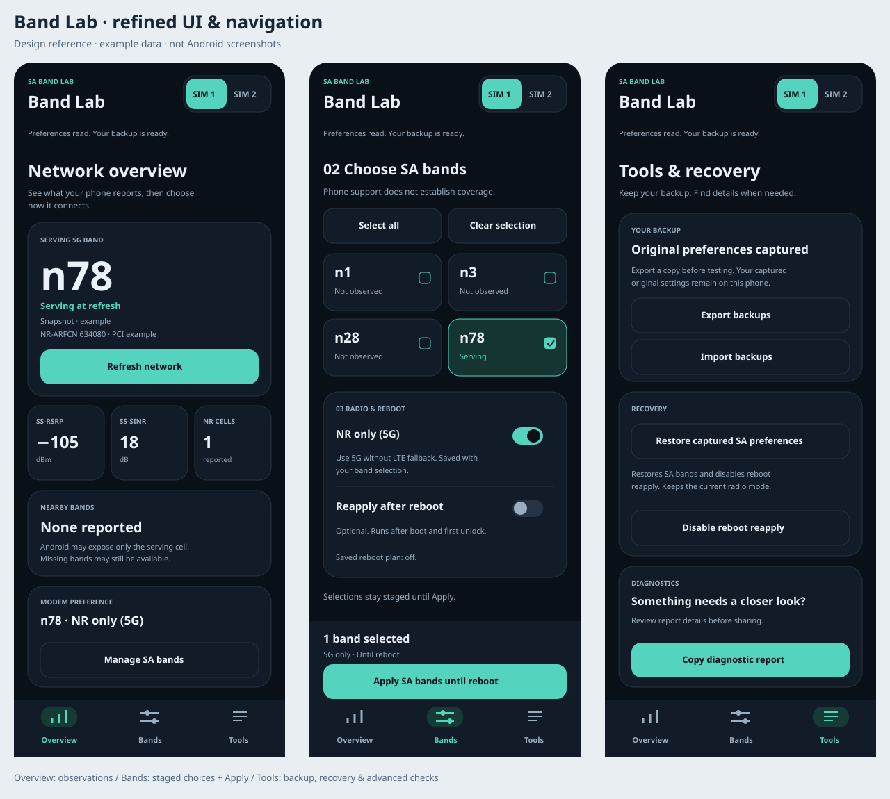

# UI and navigation redesign

Version **0.10** packages the original three-tab redesign and launcher icon.
Version **0.11** adds **Speedtest between Bands and Tools**. Android rendering and device interaction still need
phone testing. Install official APK updates over the previous app to retain
backups.

Version **0.12** adds a native speedometer, three result tiles,
a duration selector, collapsed explanations and compact tap-to-open reports.
[Speedtest preview](assets/speedtest-overview.svg) is illustrative, not an Android
screenshot. Full source behavior is described in [SPEEDTEST.md](SPEEDTEST.md).

The image illustrates the earlier 0.10 three-tab layout with example data, **not Android
screenshots or evidence of phone behavior**. The Bands panel is shown at the
selection area; its read/backup card is above it in the scrollable page. The
real grid contains only verified selectable bands for the chosen phone/SIM.

## Five destinations in current source

**Version 0.15 adds Signal between Bands and Speedtest.**

| Destination | Purpose and actions |
| --- | --- |
| **Overview** | Refresh Android cell observations; see the reported serving band, RSRP, SINR, NR cell count and nearby bands. Check modem preferences separately. Expand cell details when needed. |
| **Bands** | Read live preferences and capture/verify the backup. Select SA bands in a responsive grid, use Select all or Clear selection, and stage NR-only/reboot options. Review the selection count and use the one Apply action. |
| **Signal** | Start/pause serving-NR signal hunting. Read the segmented SS-RSRP gauge, best for this cell, independent quality measurements and 60-second trend. Mark readings for this session or opt into sound. |
| **Speedtest** | Run a confirmed cellular-only download/upload/HTTP-ping test. Stop a run, compare local reports for this SIM, copy reports or clear history. Every result carries serving-band observations from during the run. |
| **Tools** | Export/import backups, restore captured SA preferences, disable boot reapply, copy diagnostics, inspect phone capabilities and open network settings. Optional modem-frequency and legacy EFS reads sit under Advanced modem checks. |

The header keeps a two-button SIM selector visible. The bottom navigation keeps
all five destinations one tap away. Pages retain their views and scroll state
when switching tabs, so tab changes do not reset checkbox choices or initiate
root/network operations. Back from another tab returns to Overview. Signal
sampling pauses when leaving its tab; returning requires Resume. Saved page
indexes from the earlier four-tab layout are migrated without moving a restored
Speedtest page to Signal.

## Signal hunt

See [SIGNAL_HUNT.md](SIGNAL_HUNT.md) for the beginner flow and limits. Native
Canvas views draw the segmented gauge and actual-time trend. There are no demo
measurements in the Android screen. The selected subscription supplies serving
NR readings, timestamps and independent SS-RSRP/SS-SINR/SS-RSRQ fields. Unknown,
ambiguous or stale data stays unavailable. Best/delta comparisons reset when
cell, channel or band changes; incomplete cell identity disables comparisons.

Start/Pause, Mark spot and opt-in Sound actions sit below the trend. Marked
readings are grouped in a collapsed session-only panel, with no GPS capture.
Help is collapsed. Navigation/background/SIM changes pause sampling and release
audio; a visible active hunt keeps the screen awake. Android 11 uses the legacy
cell listener, and Android 12+ uses TelephonyCallback with the same freshness
rules. Device rendering and callback delivery are still unverified.

## Band selection and recovery

- A live read and matching backup are required before selecting/applying bands.
  Missing capabilities, invalid mode, busy state or zero selection disable Apply.
- Selection count and **UNAPPLIED** indicate staged changes. NR-only and reboot
  switches only edit the draft; the existing Apply confirmation and combined
  SA/mode helper request perform the change.
- The Apply footer stays visible in normal portrait layouts. On short windows
  it moves into the scrollable content so it cannot consume the entire page.
- Changing SIM or leaving the app with an unapplied draft asks whether to
  discard it. Merely switching tabs preserves it.
- An explicit reread preserves unapplied choices that remain selectable. After
  activity recreation, the page/slot/draft are remembered, but a fresh read is
  required before re-enabling writes and restoring the choices for review.
- Failed Apply retains choices for review after a successful reread; it does
  not automatically retry a write. Native compare-before-SET, verification,
  rollback, original backups and boot-plan rules remain in effect.
- Restore keeps the captured-byte behavior and confirmation. It lives in Tools
  with an explanation that the current radio mode is preserved.

## Speedtest and history

See [SPEEDTEST.md](SPEEDTEST.md) for the beginner flow and measurement details.
The source adds a timed 20s/60s four-stream cellular benchmark, explicit data-use confirmation,
a Stop action, measured-average dial, result tiles and compact local history.
Successful prior phases remain visible as Partial results after an upload failure.
Long timed tests have no fixed MB cutoff and may consume several GB; the
confirmation and expandable details explain this. Unapplied band choices block testing.
The selected SIM must be both the default and active data SIM; each HTTP request
is pinned to the same cellular Network. Route/SIM changes fail the run.
Results are labeled incomplete when cancelled or failed, retaining any completed
measurements for diagnosis. The modem helper and backup protocol are unchanged.

## Clear observation and permission states

Before a refresh, unknown values display a dash rather than fabricated numbers.
An actual empty cell list can report zero. Neighbor cells are never promoted to
the serving-band hero. Cached results are labeled because they may contain
other SIMs; sample ages continue to advance locally, without background modem
queries. Samples older than 30 seconds become previous observations.

On Refresh network or Start speed test, a disabled system Location switch
triggers a dialog with **Open Location settings**. It opens Location settings;
return and tap the action again. If Location is already enabled, no Location
switch dialog appears. Permission prompts are separate and only shown if needed.

Before requesting Phone/Precise location, the app explains Android's cell-info
requirement and that the app does not request GPS coordinates or upload location.
Root preference control remains separate from Android cell-observation access.

The operation status stays visible on every page, with a progress indicator
while work runs. Tap it for the full message and a Copy report action. Optional
legacy EFS errors explain that they do not establish a failed QMI band lock.

## Visual and accessibility details

- Midnight navy surfaces, mint primary actions, restrained borders and grouped
  cards match the launcher icon. Restore uses an amber text accent.
- Buttons, SIM targets, switches, status details and tab targets have generous
  touch areas. Native checked/selected state and accessibility announcements
  are retained; status messages use a polite live region.
- Insets protect content from system bars and cutouts. The band grid grows to
  four columns on wider windows. Metrics stack for large font scaling, labels
  can wrap, and short windows do not reserve a fixed Apply panel.
- Native ripple feedback and a brief tab fade make actions visible without
  requiring a new UI framework or build dependency.

Implementation: [LabLayout.java](../android/src/dev/saband/lab/LabLayout.java)
contains views/navigation, [UiPresentation.java](../android/src/dev/saband/lab/UiPresentation.java)
contains host-testable UI decisions, and
[MainActivity.java](../android/src/dev/saband/lab/MainActivity.java) retains the
existing operation/controller boundary. The Android theme is in
`android/res/values/styles.xml`.

## Validation and remaining checks

The new Signal source passes eight Java host suites, full Android Java and
minimum-API-30 DEX compilation. Signal state tests cover fresh/stale timestamps,
duplicates, out-of-order callbacks, cell/band resets, graph gaps, unknown fields,
session mark limits and navigation migration. The signed 0.15 APK also passes
AAPT2 packaging, ZIP alignment, signature and contents checks. Drawing, callbacks,
audio, rotation and font scaling require phone checks.
Existing published APK evidence below is historical.

The signed 0.13 APK build passes, including Java/D8 and full AAPT2 resource
linking. Package inspection confirms the adaptive/themed icon and theme. The original five Java
host suites cover the existing observation/radio/journal/boot logic plus the
new Apply gates, draft detection, mask labels, and fresh/stale/cached/neighbor
presentation. No native helper protocol code changed. These checks do not
execute Android views or prove runtime layout, focus order, launcher behavior,
font scaling or navigation on the phone. Review those using the 0.13 APK.

The speed-test source additionally passes transfer-loop and report/history host
tests and Android Java compilation. A tiny live 1 KB download/upload smoke check
passed against Cloudflare. Android cellular routing, Location settings prompts,
serving updates, actual speed accuracy and lifecycle behavior still require a
phone test; host mocks do not establish those results. Speedtest was introduced
in 0.11; the meter and sustained-test revisions ship in 0.12.

Android design references:
[navigation patterns](https://developer.android.com/design/ui/mobile/guides/layout-and-content/layout-and-nav-patterns),
[window insets](https://developer.android.com/reference/android/view/WindowInsets),
[touch target guidance](https://support.google.com/accessibility/android/answer/7101858).

Version 0.13 phase isolation retains this layout. Its shared outcome
label reads **Speeds measured · ping unavailable** if both rate phases finish
without latency, and keeps missing ping as a dash. Full reports add per-phase
HTTP-operation diagnostics. This fix ships in 0.13; phone validation is pending.

## 0.13 Quick Settings tile

Tools has a 5G tile card showing its saved SIM/bands and two actions: Configure
5G tile and Add tile to Quick Settings. Choose the SIM above and read live
preferences first. The scrollable configuration contains a separate checkbox
per verified band, Select all/Clear and Save & use LTE only. This explicit save
establishes LTE-only as the default off mode; it preserves any manual Bands draft.

The monochrome 5G icon is original vector artwork. Android 13+ offers the system
add-tile prompt, with manual edit instructions for older Android/OEM behavior.
Long press opens Tools. An unconfigured tile opens Tools on tap without writing.
On applies tile bands + NR-only together; off applies mode-only LTE, preserving
SA/NSA/LTE band masks. The tile controls its saved SIM, independent of the app's
current SIM selector, and clears that slot's boot reapply before a change.

The panel reads live preferences: active means NR-only, inactive LTE-only or an
explicit Other mode/Unknown subtitle. NR-only with different bands remains
active and is labeled Other bands, so a tap can turn it off. Reading/applying
shows Working; no optimistic on/off update. Secure lock requires unlock before
mutation. Busy operations fail promptly without a deferred toggle. Changes last
until reboot; adding/opening the tile never writes or establishes a boot policy.
Android lifecycle, HyperOS tile display, background root and live registration
need phone testing.

Implementation follows [Android's TileService guidance](https://developer.android.com/develop/ui/views/quicksettings-tiles)
and [API 34 PendingIntent launch requirements](https://developer.android.com/reference/android/service/quicksettings/TileService).
LTE/NR RAT flags follow the [public libqmi NAS definitions](https://github.com/linux-mobile-broadband/libqmi/blob/main/src/libqmi-glib/qmi-enums-nas.h).

The signed 0.13 package inspection confirms the protected exported tile service,
5G drawable, long-press intent and tile transaction classes. Seven core Java
suites, report/history and real localhost HTTP suites plus 52 native modem mock
cases pass. This does not execute TileService/SystemUI on Android or establish
HyperOS background root behavior.

## Interrupted rates in 0.14

Main result tiles retain speeds measured before ordinary endpoint errors and
append an asterisk to the affected direction. The status says which direction
was interrupted and that speeds were saved. The caption shows actual measured
time and explains a server rate limit when HTTP 429 caused it. Compact history
retains both numbers with the same marker; the full report spells out interrupted
samples, measured/requested time, serving bands, ping and error diagnostics.
The sample is not labeled a full-duration success. Older history without the
new metadata remains readable; an old null rate is not guessed from traffic.

The signed 0.14 package passes Java/D8/AAPT2, signature and contents checks,
including the new measurement classes and interrupted labels. Nine host suites
(including the real localhost HTTP 429 scenario) and 52 native mocks pass.
This does not execute the updated Android screen; a phone run is still needed.
